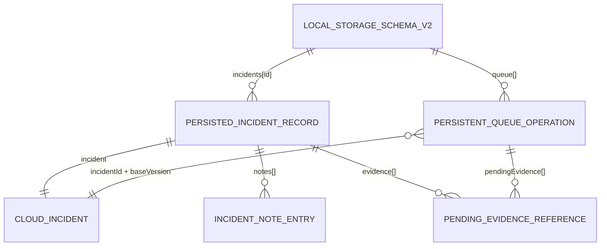

# Modelo de datos local, cola persistente y migración (Semana 08)

## 1. Propósito y separación de responsabilidades

En CampusOps, el personal técnico necesita consultar incidencias asignadas, iniciar atención (`start`), agregar notas (`comment`) y registrar referencias a evidencias fotográficas (`add_evidence`) en zonas del campus sin cobertura de red. Al mismo tiempo, coordinación puede reasignar (`assign`) o repriorizar (`prioritize`) incidencias en el servidor.

Para preservar la integridad de ambos hechos y sobrevivir al cierre o reinicio de la aplicación, el almacenamiento se divide según la sensibilidad de los datos (manteniendo los controles de las semanas 4 y 6):

| Tipo de dato | Almacenamiento elegido | Clave / Ubicación | Justificación |
|---|---|---|---|
| **Secretos de sesión** (`accessToken`, `refreshToken`, `actorId`, `role`, `generation`) | `ExpoSecureSessionStorage` (`expo-secure-store`) | `campusops.session.v1` | Cifrado respaldado por Keystore/Keychain del sistema operativo; nunca se mezcla con el almacén de incidencias ni con logs. |
| **Estado operativo local y cola de sincronización** (incidencias cacheadas, notas, referencias de evidencia pendiente y cola de operaciones) | `PersistentIncidentStore`; en la app usa `ExpoSecureKeyValueDriver` y en integración Node usa `FileKeyValuePersistenceDriver` con reemplazo atómico `.tmp + rename` | Claves `campusops.offline.db.v2` y `campusops.offline.db.backup`; namespace nativo aislado `mx.edu.dmi.campusops.offline` | Está separado de los secretos de sesión, sobrevive a la reconstrucción del proceso y permite probar persistencia física real. Una lista únicamente en memoria (`InMemoryIncidentRepository`) no cumple este requisito. |

---

## 2. Versión de esquema

- **Versión anterior (`LEGACY_SCHEMA_VERSION = 1`):** almacenaba incidencias planas (`assignedTo` escalar, sin separación explícita de estado de subida de evidencias) y una lista `pendingQueue` con claves abreviadas (`opId`, `version`, `actor`, `body`).
- **Versión actual (`CURRENT_SCHEMA_VERSION = 2`):** definida en `src/domain/sync/OfflineSyncTypes.ts` (`LocalStorageSchemaV2`). Añade `schemaVersion: 2`, `migratedFromVersion`, registros enriquecidos `PersistedIncidentRecord` con `lastSyncedVersion`, notas tipadas, referencias de evidencia con estado de subida explícito (`uploadState: 'pending_upload' | 'uploaded'`) y la cola estructurada `PersistentQueueOperation`.

---

## 3. Entidades y relaciones del esquema v2



### 3.1 `PersistedIncidentRecord`

Representa el estado local conocido de una incidencia del contrato público (por ejemplo, `campus-inc-001` reportada por `reporter-1` y asignada inicialmente a `technician-1` en `version: 1`):

- `incident`: objeto `CloudIncident` validado (`id`, `version`, `status`, `category`, `description`, `location`, `priority`, `reporterId`, `assignedTechnicianId`).
- `lastSyncedVersion`: última versión confirmada con el backend (`number`).
- `notes`: lista de `{ actorId, text }` asociadas a la incidencia.
- `evidence`: lista de `PendingEvidenceReference` asociadas a la incidencia.

### 3.2 `PendingEvidenceReference` (referencia a fotografía pendiente)

Una referencia de fotografía en la cola o en el registro local **identifica un recurso local pendiente de carga y no demuestra que la imagen binaria ya se haya subido al servidor**:

```ts
interface PendingEvidenceReference {
  readonly evidenceId: string; // ej. "ev-campus-001-photo-1"
  readonly localUri: string;   // ej. "file:///data/user/0/.../pending/ev-campus-001-photo-1.jpg"
  readonly mimeType: 'image/jpeg' | 'image/png';
  readonly uploadState: 'pending_upload' | 'uploaded';
}
```

Mientras la operación `add_evidence` no sea confirmada por el servidor, `uploadState` permanece en `'pending_upload'`, evitando falsos positivos de carga completada tras reiniciar la app.

### 3.3 Estructura de la cola persistente (`PersistentQueueOperation`)

Cada cambio originado sin conexión o pendiente de confirmación se persiste en `queue` con los siguientes campos obligatorios:

| Campo | Tipo | Descripción |
|---|---|---|
| `operationId` | `string` (mín. 8 caracteres) | Identidad única y estable de la operación; se envía como `Idempotency-Key` al sincronizar o reintentar. |
| `incidentId` | `string` | Identificador de la incidencia objetivo (ej. `campus-inc-001`). |
| `baseVersion` | `number` | Versión base del recurso sobre la que el actor tomó la decisión local (ej. `1`). |
| `actorId` | `string` | Actor público que originó el cambio (ej. `technician-1`). |
| `action` | `IncidentActionName` | Acción solicitada (`start`, `resolve`, `comment`, `add_evidence`, `assign`, `prioritize`, `close`, `reopen`). |
| `payload` | `IncidentActionInput` | Contenido completo de la operación (`action`, `baseVersion` y campos propios de la acción). |
| `createdAt` | `string` (ISO 8601) | Marca temporal determinista de creación en cola. |
| `status` | `'pending' \| 'conflicted' \| 'failed'` | Estado en la cola. Un conflicto o error de red cambia el diagnóstico pero **no descarta** la operación. |
| `conflictFields` | `readonly string[]` (opcional) | Campos en conflicto detectados por `resolveSync` (ej. `['work']`). |
| `pendingEvidence` | `readonly PendingEvidenceReference[]` (opcional) | Metadatos de fotografías locales vinculadas a la operación pendiente. |

---

## 4. Procedimiento de migración y recuperación atómica (Rollback)

Cuando la aplicación abre el almacén local (`PersistentIncidentStore.initialize()`), inspecciona la versión almacenada antes de exponer datos a los casos de uso:

1. **Detección de versión:**
   - Si el almacén ya está en `schemaVersion: 2`, valida la integridad estructural de `incidents` y `queue` y restaura el estado sin modificar identidades.
   - Si detecta `schemaVersion: 1`, inicia una transacción de migración `v1 → v2`.
2. **Respaldo previo (Snapshot transaccional):**
   - Antes de escribir cualquier clave del esquema v2, guarda una copia íntegra del estado crudo v1 en la ranura de respaldo transaccional (`backupKey`) y trabaja sobre un árbol de memoria aislado (staging).
3. **Transformación en etapas verificadas:**
   - **Etapa 1 (Incidencias):** transforma cada `LegacyIncidentRecordV1` (`assignedTo` → `assignedTechnicianId`, inicializa `notes: []`, `evidence: []`, `lastSyncedVersion: version`).
   - **Etapa 2 (Cola de operaciones):** transforma cada `LegacyQueueOperationV1` conservando intactos `opId` → `operationId`, `incidentId`, `version` → `baseVersion`, `actor` → `actorId`, `action` y `body` → `payload`, además de mapear `evidenceIds` a `PendingEvidenceReference` con `uploadState: 'pending_upload'`.
   - **Etapa 3 (Commit):** construye el documento v2 completo en memoria, deduplica la cola conservando la primera aparición y sólo entonces persiste `schemaVersion: 2` y elimina el respaldo.
4. **Manejo de falla e integridad por Rollback:**
   - Si ocurre una interrupción o falla inyectada durante cualquiera de las etapas antes del commit final, el manejador `catch` restaura inmediatamente el snapshot crudo de `backupKey` sobre la clave principal.
   - Si el proceso termina antes de ejecutar ese `catch`, el siguiente `initialize()` detecta el respaldo pendiente, restaura primero el snapshot v1 y vuelve a ejecutar la migración; el documento parcial nunca se expone.
   - De este modo, **nunca queda parte del esquema v2 mezclado con el esquema v1**, ni se pierden incidencias u operaciones pendientes.
   - En el siguiente intento de inicialización sin falla inyectada, la migración se reejecuta desde el estado v1 íntegro y completa la transición a `schemaVersion: 2`.
